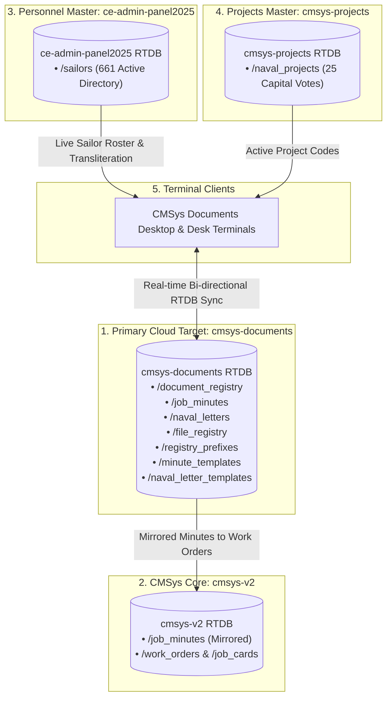

# CMSys Documents — Advance Naval Document Management System

[](#)
[](#)
[](#)
[](#)
[](#)

> **Official Document Registry, Directed Minute Sheet Studio & BR 7 Naval Correspondence System**  
> Developed for the **Command Civil Engineering Department (East)** — Sri Lanka Navy.

---

## ⚓ Overview

**CMSys Documents** is the mission-critical document processing, correspondence tracking, and minute drafting engine within the **CMSys V2 Naval Productivity Ecosystem**. It bridges administrative registries, official naval file indexes, and cross-zone engineering allocations.

### Key Capabilities
- **Naval Document Registry**: Centralized record keeping across 4 administrative desks (CCED Writer Desk, Admin Office, Drawing Office, and Minute Sheets) with full Inward, Outward, Transit, and Confidential classification tracking.
- **Naval Minute Sheet Studio**: Real-time Sinhala & English transliteration, official navy minute sheet typography, auto-generated sequence numbering, and cross-linking to capital works.
- **BR 7 Naval Letter Studio**: Formal naval correspondence generator strictly adhering to Book of Reference 7 (BR 7) protocol, formal naval salutations, hierarchical tone presets (Senior / Peer / Subordinate), and registered outgoing auto-dispatch.
- **Master Naval File Registry**: Categorized file indexing with physical drawer/box location tracking, folio counts, and lifecycle management.
- **Federated Ecosystem Integration**: Seamlessly shares real-time data with `cmsys-v2` (tactical work orders), `ce-admin-panel2025` (661 active sailors directory), and `cmsys-projects` (capital vote projects).

---

## 🏛 Multi-Cluster Architecture



---

## 🗂 Project Structure

```
CMSys Documents/
├── .firebaserc               # Firebase project target designation
├── .gitignore                # Production ignore configuration
├── api.php                   # Secure backend REST API & Firebase proxy
├── app.js                    # Reactive application engine (state, API, BR 7 rules)
├── config.php                # Database singleton, endpoints & security headers
├── database.rules.json       # Firebase Realtime Database security & index rules
├── firebase.json             # Firebase deployment configuration
├── FIREBASE_TOPOLOGY.md      # Ecosystem architecture & schema documentation
├── index.html                # Entry point — hands off to the Command Deck
├── workstation.html          # Command Deck shell (rail, command bar, 4 views, modals)
├── css/
│   ├── deck.css              # Design system — tokens, frame, components, motion
│   ├── studio.css            # Registry instrumentation & drafting board chrome
│   └── paper.css             # Millimetre A4 paper contract + isolated print rules
├── js/
│   ├── skin.js               # Presentation layer — every renderer & paper preview
│   └── deck.js               # Chrome interactions — palette, clock, zoom, toasts
├── dev/
│   └── preview-server.mjs    # Node-only preview server with mock API (not deployed)
├── meta_cache.json           # Cached ecosystem bootstrap data
├── seed-firebase-documents.js# Firebase database initialization & seeder
├── seed_templates.php        # Default naval minute & letter template seed script
├── setup_db.php              # Local MySQL (ncw_ps_db) schema migration script
├── sinhala-fonts.css         # Offline @font-face declarations (Sinhala + Latin)
├── style.css                 # Legacy theme sheet — superseded by css/, kept for reference
├── tailwind-static.css       # Legacy utility sheet — superseded by css/
├── Docs/                     # Official naval documentation & specifications
└── fonts/                    # High-fidelity Sinhala & system typography
```


---

## 🎛 Command Deck — Interface Architecture

The workstation is a zero-build, air-gapped single-page application. There is no
bundler, no framework and no network dependency: three CSS layers, two JS layers
and the PHP API are the whole system.

```
sinhala-fonts.css → css/deck.css → css/studio.css → css/paper.css
firebase-*-compat.js → app.js → js/skin.js → js/deck.js
```

| Layer | Owns | Never touches |
|---|---|---|
| `app.js` | State, API calls, BR 7 numbering rules, ref generation, modal orchestration | Class strings, colours, markup |
| `js/skin.js` | Every renderer: registry table, builder cards, libraries, settings, both paper previews, compliance strips | State transitions, fetch |
| `js/deck.js` | Command palette, SLST clock, focus mode, canvas zoom/fit, toasts, animated counters, shortcuts, ledger print | Business rules |
| `css/deck.css` | Design tokens, rail, command bar, cards, tables, modals, palette | Paper geometry |
| `css/studio.css` | Registry instrumentation, drafting board, print-studio chrome, settings workbench | Print output |
| `css/paper.css` | A4 millimetre contract, document primitives (`.pp__*`), `@media print` purity | Application chrome |

### Design language

Deep-water navy chrome, brass insignia, signal-teal telemetry and a paper-white
sheet. Day watch (`html:not(.dark)`) swaps the chrome for ivory chart paper while
the rail keeps its navy weight. Display type is Humanist 521 Light, interface type
is the Google Sans variable face, and every Sinhala run is held at ≥ 1.6 leading
so diacritics never clip.

### Interaction map

| Shortcut | Action |
|---|---|
| `Ctrl / ⌘ K` | Command palette (18 runnable actions) |
| `Ctrl / ⌘ ⇧ L` | Focus mode — hide rail and command bar |
| `Ctrl / ⌘ ⇧ D` | Day / night watch |
| `1 … 4` | Registry · BR 7 letter · Minute sheet · Settings |
| `/` | Jump to registry search |
| `+` `−` `0` | Zoom the live sheet · fit to board |
| `?` | Keyboard map |
| `Esc` | Close palette, prompt or modal |

### Paper contract

The live sheet and the print output share one geometry source: A4 210 × 297 mm,
padding `25.4mm 15mm 25.4mm 38.1mm`, with classification markings top and bottom
centre, precedence and copy control top right. `printIsolatedHTML()` re-injects
`css/paper.css` into a hidden iframe, so a BR 7 letter or minute sheet prints
without any application chrome ever reaching the page.

---

## 🧪 Design Preview (no PHP required)

`dev/preview-server.mjs` serves the static bundle and answers `api.php?action=…`
with representative fixtures, so the interface can be reviewed on any workstation
that has Node 20+ — no Apache, PHP, MySQL or Firebase:

```bash
node dev/preview-server.mjs            # → http://localhost:8080
PORT=3000 node dev/preview-server.mjs
```

Fixtures cover twelve registry files, five outgoing prefixes, six physical files,
four minute templates, three BR 7 letters and the live `meta_cache.json` sailor
directory. The folder is excluded from Firebase Hosting and is never part of the
production bundle.

---

## 🚀 Setup & Installation

### 1. Prerequisites
- **Web Server**: Apache 2.4+ (XAMPP recommended on Windows: `c:\xampp\htdocs\CMSys Documents`)
- **PHP**: PHP 8.1+ with `pdo_mysql`, `curl`, `json`, `mbstring` enabled
- **Database**: MySQL 5.7+ / MariaDB 10.4+ (`ncw_ps_db`)
- **Internet / Network**: Access to Firebase Realtime Database endpoints

### 2. Local Database Initialization
Run the database migration scripts via browser or CLI:
```bash
# Set up MySQL tables
php setup_db.php

# Seed default naval templates and file registry entries
php seed_templates.php
```

### 3. Firebase Deployment
To deploy Realtime Database rules and indexes:
```bash
firebase deploy --only database
```

### 4. Running the Application
Open your browser and navigate to:
```
http://localhost/CMSys%20Documents/
```

---

## 🛡 Security & Compliance Standards

- **Naval BR 7 Standard**: Strict formatting of margins, reference numbering, paragraph indentation, complimentary closes, and security classifications.
- **OWASP Top 10 Protections**:
  - Exclusively uses **PDO Prepared Statements** for all SQL queries.
  - Strict input sanitization and UTF-8 encoding support for Sinhala Unicode.
  - Hardened HTTP response headers (`X-Frame-Options: SAMEORIGIN`, `X-Content-Type-Options: nosniff`).
- **Headcount & Allocation Invariants**: Zero data loss across federated personnel queries and active zone assignments.

---

## 📜 License & Restrictive Notice

Confidential & Proprietary. Developed strictly for the **Command Civil Engineering Department (East), Sri Lanka Navy**. Unauthorized copying, distribution, or alteration is strictly prohibited under naval regulations.
