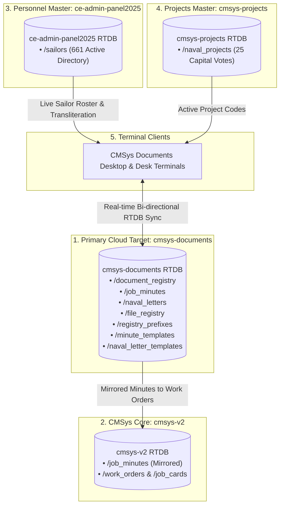

# CMSys Documents — Advance Naval Document Management System

[](#)
[](#)
[](#)
[](#)
[](#)

> **Official Document Registry, Directed Minute Sheet Studio & BR 7 Naval Correspondence System**  
> Developed for the **Command Civil Engineering Department (East)** — Sri Lanka Navy.

---

## ⚓ Overview

**CMSys Documents** is the mission-critical document processing, correspondence tracking, and minute drafting engine within the **CMSys V2 Naval Productivity Ecosystem**. It bridges administrative registries, official naval file indexes, and cross-zone engineering allocations.

### Key Capabilities
- **Naval Document Registry**: Centralized record keeping across 4 administrative desks (CCED Writer Desk, Admin Office, Drawing Office, and Minute Sheets) with full Inward, Outward, Transit, and Confidential classification tracking.
- **Naval Minute Sheet Studio**: Real-time Sinhala & English transliteration, official navy minute sheet typography, auto-generated sequence numbering, and cross-linking to capital works.
- **BR 7 Naval Letter Studio**: Formal naval correspondence generator strictly adhering to Book of Reference 7 (BR 7) protocol, formal naval salutations, hierarchical tone presets (Senior / Peer / Subordinate), and registered outgoing auto-dispatch.
- **Master Naval File Registry**: Categorized file indexing with physical drawer/box location tracking, folio counts, and lifecycle management.
- **Federated Ecosystem Integration**: Seamlessly shares real-time data with `cmsys-v2` (tactical work orders), `ce-admin-panel2025` (661 active sailors directory), and `cmsys-projects` (capital vote projects).

---

## 🏛 Multi-Cluster Architecture



---

## 🗂 Project Structure

```
CMSys Documents/
├── .firebaserc               # Firebase project target designation
├── .gitignore                # Production ignore configuration
├── api.php                   # Secure backend REST API & Firebase proxy
├── app.js                    # Reactive frontend application controller
├── config.php                # Database singleton, endpoints & security headers
├── database.rules.json       # Firebase Realtime Database security & index rules
├── firebase.json             # Firebase deployment configuration
├── FIREBASE_TOPOLOGY.md      # Ecosystem architecture & schema documentation
├── index.html                # Master single-page UI application
├── meta_cache.json           # Cached ecosystem bootstrap data
├── seed-firebase-documents.js# Firebase database initialization & seeder
├── seed_templates.php        # Default naval minute & letter template seed script
├── setup_db.php              # Local MySQL (ncw_ps_db) schema migration script
├── sinhala-fonts.css         # Embedded Sinhala font typography rules
├── style.css                 # Custom naval theme, layout & print styles
├── tailwind-static.css       # Tailwind CSS core styles
├── Docs/                     # Official naval documentation & specifications
└── fonts/                    # High-fidelity Sinhala & system typography
```

---

## 🚀 Setup & Installation

### 1. Prerequisites
- **Web Server**: Apache 2.4+ (XAMPP recommended on Windows: `c:\xampp\htdocs\CMSys Documents`)
- **PHP**: PHP 8.1+ with `pdo_mysql`, `curl`, `json`, `mbstring` enabled
- **Database**: MySQL 5.7+ / MariaDB 10.4+ (`ncw_ps_db`)
- **Internet / Network**: Access to Firebase Realtime Database endpoints

### 2. Local Database Initialization
Run the database migration scripts via browser or CLI:
```bash
# Set up MySQL tables
php setup_db.php

# Seed default naval templates and file registry entries
php seed_templates.php
```

### 3. Firebase Deployment
To deploy Realtime Database rules and indexes:
```bash
firebase deploy --only database
```

### 4. Running the Application
Open your browser and navigate to:
```
http://localhost/CMSys%20Documents/
```

---

## 🛡 Security & Compliance Standards

- **Naval BR 7 Standard**: Strict formatting of margins, reference numbering, paragraph indentation, complimentary closes, and security classifications.
- **OWASP Top 10 Protections**:
  - Exclusively uses **PDO Prepared Statements** for all SQL queries.
  - Strict input sanitization and UTF-8 encoding support for Sinhala Unicode.
  - Hardened HTTP response headers (`X-Frame-Options: SAMEORIGIN`, `X-Content-Type-Options: nosniff`).
- **Headcount & Allocation Invariants**: Zero data loss across federated personnel queries and active zone assignments.

---

## 📜 License & Restrictive Notice

Confidential & Proprietary. Developed strictly for the **Command Civil Engineering Department (East), Sri Lanka Navy**. Unauthorized copying, distribution, or alteration is strictly prohibited under naval regulations.
